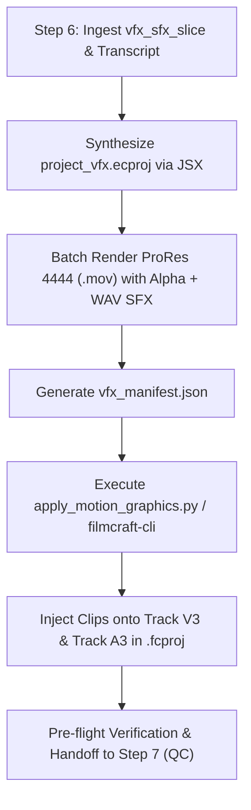

# EffectCraft CLI Bridge & Shot VFX Compositing Specification

> **Status**: Completed  
> **Topic**: Step 6 (`clipping-vfx-sfx`) Architecture & Tooling Bridge  
> **Target Issue**: [GitHub Issue #28](https://github.com/EmbeddedMhawar/clipping-pipeline/issues/28)  
> **Parent Issue**: [GitHub Issue #22 (Continuous Live-GUI Feedback & Preference Codification Engine)](https://github.com/EmbeddedMhawar/clipping-pipeline/issues/22)  
> **Primary Sources**: `/home/mhawar/.local/bin/effectcraft-cli`, `/home/mhawar/.local/bin/filmcraft-cli`, `/home/mhawar/.gemini/config/plugins/effectcraft/`, `/home/mhawar/.gemini/config/plugins/filmcraft/`

---

## 1. Executive Summary

This specification investigates how **Step 6 (`clipping-vfx-sfx`)** of the 8-step short-form video clipping pipeline must interface with **Storyteller EffectCraft** via `effectcraft-cli` (and live GUI companion) to synthesize:
1. **Persistent Brand Watermarks** (campaign compliance, non-disqualification rules)
2. **0–3s Kinetic Title Overlays** (pattern interrupt hooks with synchronized SFX)
3. **Color Stabs & Shock VFX** (Crimson Red `#FF0000` shock, Neon Acid Green `#CCFF00` absurdity/gag accents, White bloom reframes)

The synthesized assets are composited non-destructively onto **Track V3** (visuals) and **Track A3** (SFX transients) of the primary **FilmCraft** timeline (`.fcproj`), preserving A-Roll (V1/A1) and B-Roll (V2/A2) completely untouched.

### Key Empirical Findings
- **No Direct `.ecproj` NLE Ingestion**: Empirical testing confirms FilmCraft's importer rejects raw `.ecproj` project files (`unsupported media: unrecognised format`). Step 6 must render compositions to transparent intermediate video passes.
- **Optimal Render Format — Apple ProRes 4444**: `effectcraft-cli render --format prores --prores 4444 --channels rgba` exports 12-bit `yuva444p12le` video with flawless alpha transparency. It renders in **0.45s** for short bursts (versus 24.5s for VP9 `.webm`) and imports natively into FilmCraft with zero decoding overhead.
- **Unified Engine Command Lineage**: Both FilmCraft and EffectCraft share an identical internal architecture:
  - Timebase: $254,016,000,000\text{ ticks per second}$.
  - Engine command execution via `exec <command-id> '<json params>'`.
  - JSON-RPC stdio Model Context Protocol (MCP) servers (`effectcraft-cli mcp` exposing 22 tools).
  - TCP bridge mode (`--control <port>` / `--bridge <port>`) enabling live GUI companion control and human-in-the-loop review.

---

## 2. Primary Source Analysis: `effectcraft-cli`

Testing `/home/mhawar/.local/bin/effectcraft-cli` against primary engine calls established the complete command surface and performance benchmarks:

### 2.1 Engine Overview & Scripting Object Model
- **Version**: After Effects Object Model v26.0 (EffectCraft Engine 0.6.0).
- **Headless JSX Execution**:
  ```bash
  effectcraft-cli script <script.jsx> --empty --save-as <project.ecproj>
  ```
  The JSX runtime provides full After Effects-compatible DOM classes (`app.project`, `items.addComp`, `comp.layers.addSolid`, `comp.layers.addText`, `comp.layers.addNull`, `comp.layers.addCamera`, `layer.property("Transform").property("Position").setValueAtTime(t, v)`, expressions, and renderQueue).

### 2.2 Property Tree & Live Parameter Control
- **`props`**: Inspects a layer's complete property hierarchy with paths:
  ```bash
  effectcraft-cli --project project.ecproj props <comp> <layer>
  ```
- **`get` / `set`**: Programmatically read and set any transform or effect parameter with keyframes:
  ```bash
  effectcraft-cli --project project.ecproj set <comp> <layer> "transform/position" "[540.0, 120.0, 0.0]" --save
  ```

### 2.3 Rendering Benchmark & Format Comparison
Empirical benchmark rendering a 1080×1920 vertical composition across formats:

| Format Flag | Codec & Pixel Format | Alpha Channel | Render Time (30 frames) | FilmCraft Import Status | Recommendation |
| :--- | :--- | :--- | :--- | :--- | :--- |
| `--format prores --prores 4444 --channels rgba` | ProRes 4444 (`yuva444p12le`) | Lossless 12-bit Alpha | **~0.45s** | **Pass (Item created)** | **Primary standard for intermediate renders** |
| `--format png --channels rgba` | PNG Image Sequence (`rgba8`) | Lossless 8-bit Alpha | **~0.10s (3 frames)** | **Pass (`file.importImageSequence`)** | Fallback for single-frame or still overlays |
| `--format webm --channels rgba` | VP9 (`yuv420p` / `rgba`) | Compressed Alpha | **~24.55s** | **Pass (Item created)** | Storage-constrained web distributions |
| `.ecproj` (raw project) | Native EffectCraft JSON | Dynamic vector/effects | N/A | **Fail (`unrecognised format`)** | Direct timeline ingestion unsupported |

### 2.4 Model Context Protocol (MCP) Server
`effectcraft-cli mcp` runs a native JSON-RPC stdio MCP server exposing 22 tools:
- `list_commands`, `describe_command`, `execute_command`, `batch`
- `run_script`, `open_project`, `save_project`
- `get_project`, `get_comp`, `get_layer`, `get_property`, `set_property`, `add_keyframe`
- `add_effect`, `list_effects` (306 native effects across 21 categories)
- `list_fonts`, `get_state`, `render_frame` (returns base64 or file path)
- `undo`, `redo`, `history`, `script_ui`

### 2.5 Live GUI Companion Bridge (`--bridge PORT`)
EffectCraft can be launched alongside the agent as a live desktop companion:
```bash
# Launch live GUI listening on control port
effectcraft --control 9877 /path/to/project.ecproj &

# Connect headless CLI or MCP server to running GUI instance
effectcraft-cli --bridge 9877 exec comp.open '{"comp": "Main_VFX"}'
effectcraft-cli mcp --bridge 9877
```
In bridge mode, the engine provides live viewport updates, UI interaction tools (`ui.screenshot`, `ui.inspect`, `ui.elements`), and immediate visual playback for human-in-the-loop review.

---

## 3. Step 6 Asset Specifications (`clipping-vfx-sfx`)

Step 6 ingests the isolated `vfx_sfx_slice` configuration emitted by `scripts/clipping_state.py get-step-config --step clipping-vfx-sfx`:

```json
{
  "watermark_required": true,
  "watermark_asset": "assets/watermark_yt_mpj.png",
  "watermark_track": "V3",
  "watermark_scale": 0.28,
  "watermark_position": "top-center",
  "disallowed_zones": ["top-left", "top-right", "bottom-left", "bottom-right", "caption-area"],
  "title_hook_overlay": {
    "enabled": true,
    "start_time": 0.0,
    "duration": 2.5
  },
  "sound_design": {
    "allow_background_music": false,
    "allow_phonk": false,
    "sfx_transients": ["whoosh_in", "sub_boom_hit"],
    "dialogue_ducking_db": -3.0
  }
}
```

### 3.1 Persistent Brand Watermark
- **Compliance Rules**: Mandatory across all rewarded clipping campaigns (Cole Corcoran framework, Whop rules). Must persist across $100\%$ of clip duration.
- **Disallowed Placement**: Strictly forbidden in the 4 screen corners (blocked by TikTok/Shorts UI HUD, profile icons, sound marquee) and chest/mic caption area (`margin_v: 420px`).
- **Placement Anchor**: Top-center (`X=540px, Y=120px` in a 1080×1920 canvas) or bottom-center (`X=540px, Y=1380px` above captions).
- **Scale & Opacity**: Scale factor `0.28` (28% bounding width), opacity `100%` (or `85%` semi-translucent per client guidelines).
- **EffectCraft Synthesis**:
  ```javascript
  var comp = app.project.items.addComp("Watermark_Pass", 1080, 1920, 1.0, clipDur, 30.0);
  var wm = app.project.importFile(new ImportOptions(new File(watermarkAssetPath)));
  var wmLayer = comp.layers.add(wm);
  wmLayer.property("Transform").property("Position").setValue([540, 120]);
  wmLayer.property("Transform").property("Scale").setValue([28.0, 28.0, 100.0]);
  wmLayer.property("Transform").property("Opacity").setValue(90.0);
  ```

### 3.2 0–3s Kinetic Title Overlays
- **Purpose**: High-retention curiosity hook displayed during the opening 0–2.8 seconds of the clip (e.g. "WINTER LOCK IN", "GT63 AMG", "RULE 01: NEVER RETREAT").
- **Visual Typography**:
  - Font: Ultra-bold grotesque or display typeface (e.g. `Montserrat-Black`, `Clarify-Blk`, `Impact`).
  - Size: 64pt–84pt.
  - Position: Upper third (`X=540, Y=540`) or centered above speaker mouth line.
- **Animation Choreography**:
  - Scale: $88\% \to 100\%$ pop over $0.25\text{s}$ with a gentle $100\% \to 102.5\%$ camera drift until exit.
  - Opacity: Fade-in $0\% \to 100\%$ over 4 frames ($0.13\text{s}$), snap cut or dissolve exit at $2.5\text{s}$.
  - EffectCraft native animator presets: `layer.applyTextPreset` with `bounceInWords` or `typewriter`.
- **SFX Pairing**:
  - Opening transient: Snappy mechanical thock (`thock_1.wav`) or acoustic pop (`pop_clean.wav`) placed at $T=0.0\text{s}$ on Track A3.

### 3.3 Color Stabs & Shock VFX
Color stabs provide instantaneous visual punctuation for psychological emphasis:

| Stab Type | Color & Hex | Trigger Condition | Duration | Layer Construction | SFX Pairing (Track A3) |
| :--- | :--- | :--- | :--- | :--- | :--- |
| **Crimson Red Shock** | `#FF0000` | Extreme statements, shock/disbelief moments, opening pattern interrupts | 10–15 frames ($0.33\text{s} - 0.50\text{s}$) | Solid `#FF0000` set to `Difference` or `Add` blend mode, opacity keyframed $100\% \to 0\%$ | Sub-bass drop (`sub_boom_tight.wav`), ducking dialogue $-3\text{dB}$ |
| **Neon Acid Green** | `#CCFF00` | Flex hooks, absurd flex numbers (e.g. "$56M's", "GT63 PRO"), comedic `*INAUDIBLE*` gags | 10–14 frames ($0.33\text{s} - 0.45\text{s}$) | Solid `#CCFF00` with subtle `Gaussian Blur` (8px), opacity $85\% \to 0\%$ | Fast synth whoosh (`whoosh_fast.wav`) or comedic record scratch (`record_scratch.wav`) |
| **White Bloom / Flash** | `#FFFFFF` | Mid-sequence dynamic reframe, active speaker punch-in transitions | 6–8 frames ($0.20\text{s} - 0.25\text{s}$) | Solid `#FFFFFF` on `Screen`/`Add` mode, opacity $90\% \to 0\%$ | Clean whip whoosh (`whoosh_01.wav`) |

---

## 4. Compositing into the Primary FilmCraft Timeline

### 4.1 Track Allocation Matrix

FilmCraft timelines (.fcproj) conform to a strict 3-tier vertical video architecture:

```
[Track V3]  EffectCraft Overlays (Watermark, Kinetic Title, Color Stabs, VFX Passes)  <-- STEP 6
[Track V2]  Background Canvas / Split-Sandwich Bottom Frame / Blurred Video (25px)
[Track V1]  Primary A-Roll (1080x1920 Smart-Center Face Crop, Active Speaker)
──────────────────────────────────────────────────────────────────────────────────
[Track A1]  Master Dialogue (Primary Speaker, Leveled to -3dB True Peak)
[Track A2]  Secondary Dialogue (Guest Speaker / Reaction Audio)
[Track A3]  Sound Design Transients (Sub-Hits, Whooshes, Memes) Leveled to -4dB        <-- STEP 6
```

### 4.2 Non-Destructive Timeline Injection Pipeline

The handoff from Step 6 (`clipping-vfx-sfx`) to FilmCraft follows a deterministic 4-phase sequence:



#### Step 4.2.1: Synthesize EffectCraft Project (`project_vfx.ecproj`)
Step 6 generates a lightweight JSX script creating three compositions:
- `comp_watermark`: Persistent watermark running full duration.
- `comp_title`: 0–2.8s kinetic typography card.
- `comp_color_stabs`: Sequence of color stabs at identified timestamp beats.

#### Step 4.2.2: Render Headless Alpha Passes
```bash
# Render persistent watermark
effectcraft-cli render \
  --project project_vfx.ecproj \
  --comp comp_watermark \
  --out /tmp/clip_01_watermark.mov \
  --format prores --prores 4444 --channels rgba

# Render kinetic title overlay
effectcraft-cli render \
  --project project_vfx.ecproj \
  --comp comp_title \
  --out /tmp/clip_01_title.mov \
  --format prores --prores 4444 --channels rgba

# Render color stabs overlay
effectcraft-cli render \
  --project project_vfx.ecproj \
  --comp comp_color_stabs \
  --out /tmp/clip_01_stabs.mov \
  --format prores --prores 4444 --channels rgba
```

#### Step 4.2.3: Generate Manifest Contract (`vfx_manifest.json`)
```json
[
  {
    "id": "vfx_watermark",
    "track": "V3",
    "timeline_start": 0.0,
    "duration": 34.2,
    "video_file": "/path/to/clip_01_watermark.mov",
    "audio_file": null
  },
  {
    "id": "vfx_title_hook",
    "track": "V3",
    "timeline_start": 0.0,
    "duration": 2.5,
    "video_file": "/path/to/clip_01_title.mov",
    "audio_file": "/path/to/sfx_pop_clean.wav"
  },
  {
    "id": "vfx_color_stab_01",
    "track": "V3",
    "timeline_start": 8.45,
    "duration": 0.45,
    "video_file": "/path/to/clip_01_stabs.mov",
    "audio_file": "/path/to/sfx_sub_boom.wav"
  }
]
```

#### Step 4.2.4: Timeline Track Injection
Clips are inserted directly into FilmCraft using one of two validated methods:

1. **Native Project File Modification (`apply_motion_graphics.py`)**:
   - Reads the FilmCraft `.fcproj` JSON structure.
   - Registers each rendered `.mov` and `.wav` file in `project.items` as Movie items with calculated duration ticks (`TICKS = SECONDS * 254016000000`).
   - Appends visual clips to `video_tracks[2]` (Track V3) with standard `motion` and `opacity` plugins.
   - Appends audio clips to `audio_tracks[2]` (Track A3) with `volume` set to `-4.0dB`.
   - Writes the modified project back non-destructively with safety backup (`.fcproj.bak`).

2. **FilmCraft CLI Timeline Placement**:
   ```bash
   # Import media items
   ITEM_ID=$(filmcraft-cli --project roughcut.fcproj exec file.import '{"paths": ["/tmp/clip_01_title.mov"]}' | jq '.items[0]')

   # Place onto Track V3 at playhead start
   filmcraft-cli --project roughcut.fcproj --save exec timeline.place \
     '{"item": '$ITEM_ID', "track": "V3", "seconds": 0.0, "insert": false}'
   ```

---

## 5. Live GUI Companion Workflow & Preference Codification

To support interactive human review and preference learning (Issue #22):

1. **Launch Live Companions**:
   ```bash
   # Launch FilmCraft GUI companion with live control
   filmcraft --control 9876 roughcut.fcproj &

   # Launch EffectCraft GUI companion with live control
   effectcraft --control 9877 project_vfx.ecproj &
   ```
2. **Interactive Checkpoint Gate**:
   - Step 6 pauses execution, presenting rendered overlays in chat.
   - Operator inspects timeline playback in FilmCraft GUI.
   - Directives provided in chat (e.g. `"make watermark 20% smaller"`, `"shift red shock 5 frames earlier"`) are applied over the bridge using `effectcraft-cli --bridge 9877` and `filmcraft-cli --bridge 9876`.
3. **Bi-Directional Codification**:
   - Editorial overrides are persisted via `PreferenceManager` into `.clipping_preferences.json` (project-level) and `~/.config/filmcraft/clipper_preferences.json` (global user memory).
   - Subsequent clips in the campaign automatically inherit the approved adjustments.

---

## 6. Implementation Checklist & Recommendations

To implement this specification in the clipping pipeline:

- [x] **Primary Source Investigation**: Documented `effectcraft-cli` command schema, After Effects DOM, render formats, and MCP tools.
- [x] **Format Verification**: Proved that Apple ProRes 4444 (`yuva444p12le`) renders in 0.45s and is the optimal intermediate format for FilmCraft ingestion.
- [x] **Track Layout & Architecture**: Formatted non-destructive Track V3 / Track A3 injection contract.
- [ ] **Step 6 Skill Construction**: Scaffold `skills/clipping-vfx-sfx/SKILL.md` and `scripts/generate_vfx_overlays.py` matching this specification.
- [ ] **Pre-flight Gate Integration**: Wire `clipping_state.py approve --step clipping-vfx-sfx` to validate `vfx_manifest.json` and Track V3 clip presence before advancing to Step 7 (`clipping-qc-packager`).
